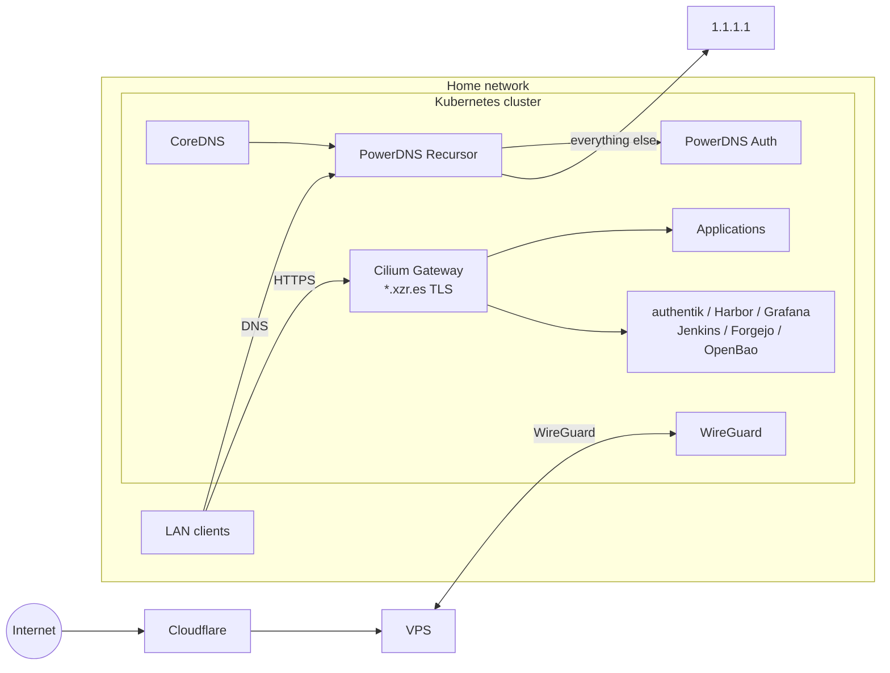
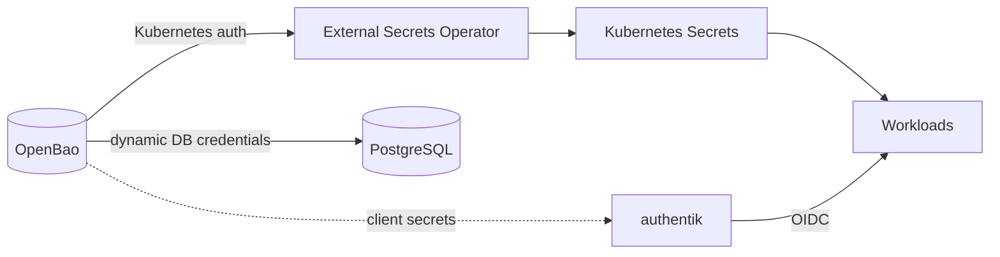

# Homelab

A three-node bare-metal Kubernetes cluster running in my home, built like production infrastructure: fully declarative, reconciled from Git, with its own PKI, identity provider, DNS and secret management. Nothing is clicked together by hand, and not a single secret lives in this repository.


## Highlights

- **GitOps end to end.** FluxCD reconciles the whole cluster from this repository in dependency-ordered stages. Pruning is on, so Git is the only source of truth.
- **Zero secrets in Git.** Every credential lives in OpenBao and reaches workloads through the External Secrets Operator. Database passwords are rotated by OpenBao every 24 hours.
- **Private PKI with an offline root.** An offline root CA signs two name-constrained intermediates: step-ca for ACME and OpenBao for internal certificates. Every web service is served over HTTPS signed by that root, and the PostgreSQL clients verify the server's certificate against it (`verify-full`).
- **Single sign-on everywhere.** authentik is the identity provider for OpenBao, Grafana, Harbor and Jenkins, and group membership in authentik decides who is an admin in each one.
- **Split-horizon DNS.** The public `xzr.es` zone lives in Cloudflare. At home, the same names resolve to internal addresses through PowerDNS.
- **Encrypted cluster network.** Cilium encrypts node-to-node traffic with IPsec and enforces mutual authentication between workloads with SPIRE. Tetragon adds runtime security observability.
- **Self-hosted delivery.** Jenkins pipelines defined as code build images with kaniko in ephemeral pods and push them to a private Harbor registry.

## Architecture



Public traffic enters through a VPS. The cluster dials out to it over WireGuard, so nothing has to be port-forwarded at home. Inside the house, a single Cilium Gateway terminates TLS for every `*.xzr.es` service, and Cilium LB-IPAM announces service IPs on the LAN over L2.

### Trust chain

```
Homelab Root CA                      offline, never touches the cluster
├── Homelab Step Intermediate CA     step-ca · ACME with DNS-01 against PowerDNS
└── OpenBao Intermediate CA          OpenBao PKI · per-service roles, exact names only
```

Both intermediates are name-constrained to `xzr.es` and `svc.cluster.local`, so a compromised issuer still could not mint a certificate for any other domain. cert-manager requests every certificate. The gateway wildcard comes from step-ca, and internal certificates such as the PostgreSQL server certificate come from OpenBao roles that only allow the exact names listed in them.

### Secrets and identity



OpenBao is the single source of truth for credentials. It stores static secrets, rotates PostgreSQL credentials and runs the internal PKI. authentik's OAuth clients are defined as blueprints, and each client secret is stored once in OpenBao, where both authentik and the application read it.

### GitOps pipeline

```
crds  →  infra-operators  →  infra-core  →  infra-services  →  apps
         Cilium              OpenBao         authentik           Mealie
         cert-manager        step-ca         Harbor              SiYuan
         External Secrets    Gateway         Grafana / Prometheus WireGuard
         CloudNativePG       PostgreSQL      Loki / Alloy        wg-beacon
         Reloader            PowerDNS        Jenkins / Forgejo
         Tetragon            CoreDNS         Valkey / external-dns
```

Each stage is a Flux `Kustomization` that waits for the previous one. That keeps operators, their CRDs and the platform services in a predictable bootstrap order.

## Stack

| Area | Components |
|---|---|
| Platform | Kubernetes 1.35, containerd, Ubuntu 24.04 |
| GitOps | FluxCD, Kustomize, Helm |
| Networking | Cilium (eBPF, IPsec, Gateway API, LB-IPAM, Hubble), WireGuard |
| DNS | PowerDNS Authoritative and Recursor, external-dns, CoreDNS, Cloudflare |
| PKI | cert-manager, step-ca, OpenBao PKI |
| Secrets | OpenBao, External Secrets Operator, Reloader |
| Identity | authentik |
| Data | CloudNativePG (PostgreSQL), Valkey |
| Observability | Prometheus, Grafana, Loki, Alloy, Tetragon |
| Delivery | Jenkins, kaniko, Harbor, Forgejo |

## Hardware

| Node | CPU | Memory | Role |
|---|---|---|---|
| node1 | 4 cores | 16 GB | control plane |
| node2 | 4 cores | 16 GB | worker |
| node3 | 4 cores | 16 GB | worker |

Storage is node-local, using persistent volumes pinned to specific nodes.

## Repository layout

```
clusters/production/         Flux entry point: stage Kustomizations and CRDs
infrastructure/stages/       What each stage deploys
infrastructure/controllers/  One directory per platform component
apps/production/             Applications
components/                  Reusable Kustomize components (network policies, pod security)
```

## Roadmap

- Enable the default-deny CiliumNetworkPolicy set in `components/network`.
- Wire Forgejo and Hubble into authentik.
- Mutual TLS from applications to PostgreSQL with client certificates from the OpenBao PKI.
